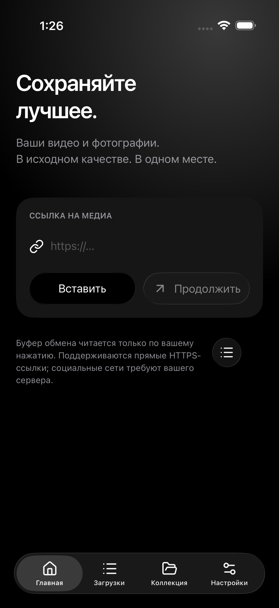
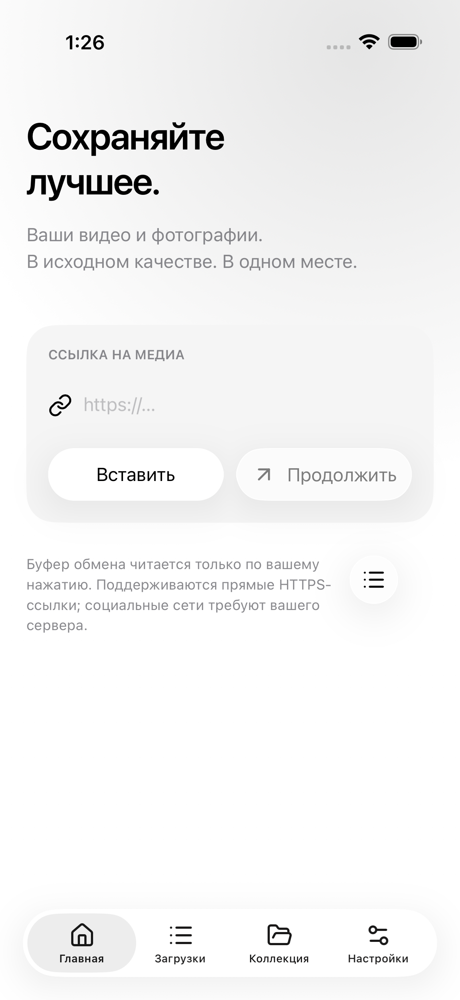
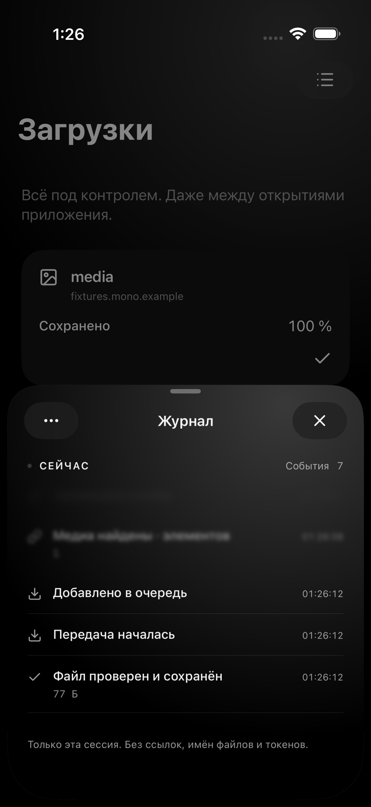

# Actual simulator captures

Exported without image editing from the successful [Actions run 39184865661](https://github.com/CORBENDALLAS111/MONO/actions/runs/39184865661), source `2b4ebe553d6587996159697fa7c8b22bb91709d6`.

iPhone Air, iOS 26.5, Xcode 26.6. `manifest.json` is the original xcresulttool attachment manifest, retaining device, test and capture timestamps. Renamed copies:

| File | Original exported attachment |
|---|---|
| Obsidian.png | D5980943-FFAB-4F36-AB4E-D37476E31D61.png |
| Porcelain.png | 77F4CA65-CD2C-4D98-A9EC-E65F55429CD4.png |
| Logs.png | CB4E8A26-F0B5-407D-93F9-AA606EF8014E.png |

Home captures exercise explicit themes. The log capture shows actual events from the deterministic Debug fixture download, not a live production transfer or fabricated sample rows. The separate live HTTPS test has its own xcresult in the logs artifact.

